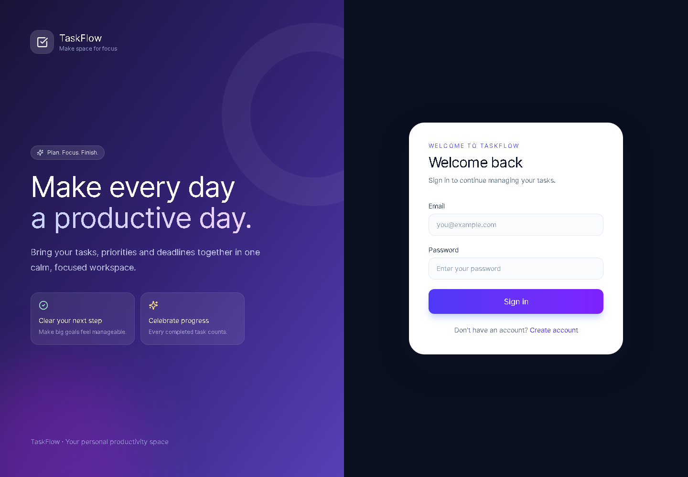

# TaskFlow

TaskFlow is a MERN task manager with a React, Vite, and Tailwind CSS frontend and an Express, Node.js, and MongoDB API.



## Features

- Account registration and login with bcrypt password hashing and JWT authentication
- Create, view, update, and delete personal tasks
- Task priorities, deadlines, status updates, search, and status filters
- Admin dashboard for viewing and removing users and tasks
- Responsive dashboard and protected routes
- Account profile page accessible from the user avatars
- Customizable workspace background with saved color presets and a custom color picker

## Requirements

- Node.js 20 or newer
- npm
- MongoDB locally, or a MongoDB Atlas cluster

## Setup

Run the API and frontend in separate terminals.

From the project root, these shortcuts are also available:

```powershell
npm run dev
npm run build
```

`npm run dev` starts the frontend. The backend still runs separately from `server` after its `.env` is configured.

### 1. Configure and run the API

```powershell
cd server
npm install
Copy-Item .env.example .env
```

Edit `server/.env` and set:

```dotenv
PORT=5000
MONGO_URI=mongodb://127.0.0.1:27017/taskflow
JWT_SECRET=replace_with_a_long_random_secret
CLIENT_URL=http://localhost:5173
ADMIN_EMAIL=admin@example.com
```

For MongoDB Atlas, replace the local `MONGO_URI` with your Atlas connection string, for example:

```text
mongodb+srv://<db_username>:<db_password>@<cluster-host>/taskflow?retryWrites=true&w=majority
```

Replace the placeholders with your Atlas database user, password, and cluster host. URL-encode special characters in the username or password. In Atlas, allow the IP address of the computer running the API and create a database user with only the permissions the app needs.

Generate a private JWT secret rather than using the example value. Keep `.env` private; never commit it or put database credentials in frontend `VITE_*` variables.

Set `ADMIN_EMAIL` to the email address you want to use as an administrator, then register that address through the app. Registration does not accept a role from the client. If `ADMIN_EMAIL` is unset, new accounts are regular users.

Start the API:

```powershell
npm run dev
```

The API listens at `http://localhost:5000`. Visiting `/` checks that the server is running.

### 2. Run the frontend

In a second terminal:

```powershell
cd client
npm install
npm run dev
```

Open the Vite URL shown in the terminal (normally `http://localhost:5173`). The default API URL is `http://localhost:5000/api`. To change it, create `client/.env` and set `VITE_API_URL`.

### Production builds

```powershell
cd client
npm run build
```

Serve the generated `client/dist` directory with a static web server and run the API with `npm start` from `server`.

## API overview

| Method | Route | Access | Purpose |
|---|---|---|---|
| POST | `/api/auth/register` | Public | Create an account |
| POST | `/api/auth/login` | Public | Sign in |
| GET | `/api/auth/me` | Signed in | Get the current account |
| GET | `/api/tasks` | Signed in | List your tasks |
| POST | `/api/tasks` | Signed in | Create a task |
| PUT | `/api/tasks/:id` | Task owner | Update a task |
| PATCH | `/api/tasks/:id/status` | Task owner | Update task status |
| DELETE | `/api/tasks/:id` | Task owner | Delete a task |
| GET | `/api/admin/overview` | Admin | View users and tasks |
| DELETE | `/api/admin/users/:id` | Admin | Delete a user and their tasks |
| DELETE | `/api/admin/tasks/:id` | Admin | Delete any task |

## Project layout

```text
client/   React application, pages, components, and API client
server/   Express API, routes, controllers, middleware, and Mongoose models
```

## Security notes

This learning project stores JWTs in browser `localStorage`. For a production deployment, consider HttpOnly secure cookies, rate limiting, stronger request validation, appropriate CSRF protection, structured logging, and automated tests. Rotate any database password that has been shared in a screenshot or message before using it.
